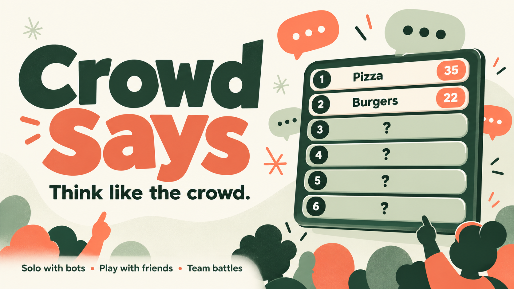
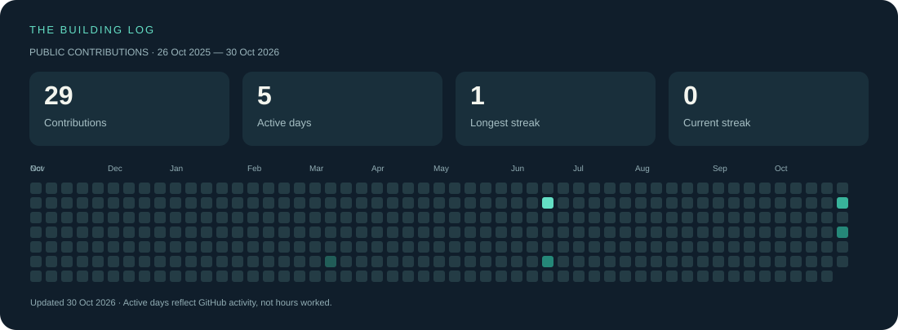

  

  <b>Building things people can use. Finding stories in data.</b> 
  JavaScript · Node.js · HTML · CSS · SQL · Git & GitHub

  <a href="https://impostor-game-lap7.onrender.com">Play my latest project</a> &nbsp;·&nbsp;
  <a href="https://github.com/NithinVChincholi?tab=repositories">Explore my repositories</a>

## Hey, I'm Nithin 👋

I like turning an idea into something you can actually try. My projects range from a live multiplayer party game to exploring retail sales with SQL. I'm learning by building, testing, and improving one project at a time.

- **Building:** interactive web experiences with JavaScript and Node.js.
- **Exploring:** data cleaning, SQL queries, and business questions in real datasets.
- **Recent launch:** **Impostor**, a word game built with AI assistance and hosted publicly on Render. Play solo with practice bots or pass one device among friends.

## Things I've made

| Project | What you can explore | Links |
| --- | --- | --- |
| **Impostor** | A word game for 4–6 players with private role cards, related-word rounds, discussion, voting, tie-breaks, and scoring. Solo practice bots or friends sharing one device. Built with HTML, CSS, and JavaScript; publicly hosted on Render. | [Play it](https://impostor-game-lap7.onrender.com) · [Source](https://github.com/NithinVChincholi/impostor-game) |
| **Crowd Says** | A live survey guessing game: practice against casual bots, compete individually, or play in teams. Room invites, timed rounds, hidden answer boards, server-side scoring, and reconnects. Built with Node.js and browser JavaScript; answer boards are AI predictions, not real survey data. | [Play it](https://crowd-says-2kl9.onrender.com) · [Source](https://github.com/NithinVChincholi/crowd-says) |
| **Retail Sales Analysis** | SQL practice covering data cleaning, exploratory analysis, category sales, customer behavior, and business questions. | [Explore the project](https://github.com/NithinVChincholi/sql_Retail_Sales_P1) |

> Crowd Says runs on free hosting. Its first visit after inactivity can take about a minute to wake up.

## Showing up, one contribution at a time

This panel uses my **public GitHub contribution calendar**, refreshed daily by GitHub Actions. Active days mean days with a visible GitHub contribution, not hours worked or total days spent learning. GitHub contributions can include commits, issues, pull requests, and repository activity; they are not just commits. Streaks use the dates shown by GitHub, and a current streak may end today or yesterday. Public calendar counts can lag behind recent activity.

<i>Small steps. Useful projects. Keep building.</i>

About this profile

Original profile layout inspired by the project-first profiles in [Awesome GitHub Profile README](https://github.com/abhisheknaiidu/awesome-github-profile-readme). Banner and activity artwork are stored in this repository; the activity panel is generated by [this script](scripts/update_activity.py). No third-party stats-card service or personal access token is required by the updater.

